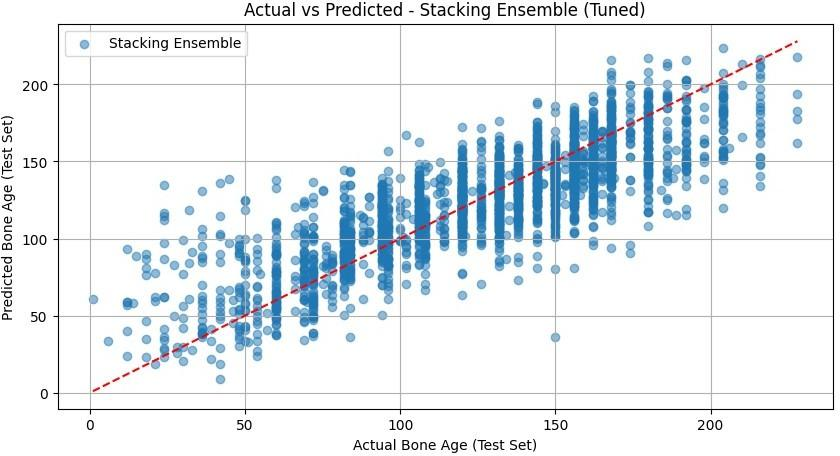
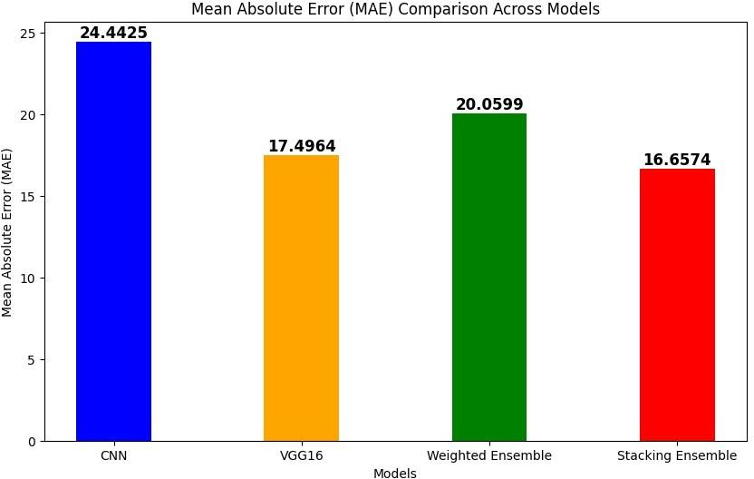

# Pediatric Bone Age Prediction from Hand Radiographs

**Deep-learning regression of skeletal age from X-ray images using a tuned custom CNN, VGG16 transfer learning, and ensemble methods**

**Author:** Prachi · MSc Computer Science, University of Delhi

---

## Overview

Skeletal maturity, or **bone age**, is a key diagnostic measure in paediatrics. It reflects a child's *biological* development more faithfully than their chronological age. It is used to:

- diagnose endocrine and metabolic disorders that affect growth, such as **growth hormone deficiency**, **hypothyroidism** and **precocious puberty**,
- predict a child's **final adult height**, and
- time **orthopaedic interventions**.

The standard clinical method, the **Greulich–Pyle (GP) atlas**, has a radiologist visually compare a left-hand X-ray against reference images. It is slow and subjective, and assessments vary considerably between readers.

This project **automates bone age assessment** with deep-learning regression, predicting bone age in months directly from a hand radiograph. It compares four approaches:

| # | Model | Idea |
|---|---|---|
| 1 | **Custom CNN** | Convolutional network trained from scratch; architecture and learning rate chosen by hyperparameter search |
| 2 | **VGG16 transfer learning** | ImageNet-pretrained VGG16 backbone (frozen) with a tuned regression head |
| 3 | **Weighted ensemble** | Error-weighted average of the CNN and VGG16 predictions |
| 4 | **Stacking ensemble** | Linear-regression meta-model that learns how to combine the two base models |

**Best result:** the stacking ensemble reached **MAE = 16.66 months**, **RMSE = 22.14 months** and **R² = 0.723** on a held-out test set of 2,523 radiographs.

---

## Dataset

**RSNA Pediatric Bone Age dataset**, a public collection of left-hand radiographs.

| Component | Description |
|---|---|
| `boneage-training-dataset.csv` | Maps each image `id` to its `boneage` (target, in months) and the patient's sex |
| `boneage-training-dataset/` | 12,611 hand X-ray images in `.png` format |
| Age range | ~1 to 228 months (0–19 years) |

Sex is available in the metadata but is not used as a model input in this version.

---

## Methodology

### 1. Preprocessing

A custom `load_images` function prepares every radiograph:

1. **Load** the image from disk, detecting and skipping missing or unreadable files.
2. **Resize** to **224 × 224** pixels, the standard input size for VGG16 and many other pretrained networks.
3. **Convert** to a NumPy array (3 channels).
4. **Normalise** pixel values from [0, 255] to **[0, 1]**, which stabilises and speeds up training.

Image–label alignment is checked before training, so that each array always matches its target age.

### 2. Data split

The 12,611 images are divided into three non-overlapping sets (fixed with `random_state=42`):

| Set | Share | Images | Role |
|---|---|---|---|
| Training | 64% | 8,070 | Fit model parameters |
| Validation | 16% | 2,018 | Hyperparameter tuning (Keras Tuner) and training the stacking meta-model |
| Test (held out) | 20% | 2,523 | Final evaluation of all four models |

### 3. Model 1: Custom CNN, tuned with Keras Tuner

Built from scratch with the Keras Sequential API:

- **2–3 blocks** of Conv2D (3×3, ReLU) + MaxPooling2D to extract hierarchical features
- **Flatten** → **Dense** (ReLU) → **Dropout** → **Dense(1, linear)** regression output
- Loss: mean squared error · Optimiser: Adam

**Keras Tuner `RandomSearch`** (10 trials, up to 20 epochs each, `EarlyStopping` on validation loss with patience 3, restoring the best weights):

| Hyperparameter | Search space | Best value |
|---|---|---|
| Conv block 1 filters | 32 – 64 | **64** |
| Conv block 2 filters | 64 – 128 | **96** |
| Extra (third) conv block | yes / no | **yes** (filters searched in 128 – 256) |
| Dense units | 256 – 512 | **384** |
| Dropout | 0.1 – 0.5 | **0.3** |
| Learning rate | 1e-3, 1e-4, 5e-5 | **1e-3** |

The search took about 9 hours on CPU.

### 4. Model 2: VGG16 transfer learning

- **VGG16 pretrained on ImageNet**, loaded with `include_top=False` to drop the original classification head.
- The convolutional base is **frozen** (`trainable = False`) and used as a fixed feature extractor.
- A new trainable regression head: Flatten → Dense → Dropout → Dense(1, linear).

**RandomSearch** over the head (5 trials, up to 15 epochs each):

| Hyperparameter | Search space | Best value |
|---|---|---|
| Dense units | 256 – 512 | **512** |
| Dropout | 0.1 – 0.5 | **0.4** |
| Learning rate | 1e-3, 1e-4, 5e-5 | **1e-4** |

The search took about 10 hours on CPU.

### 5. Ensemble methods

**Model 3: Weighted ensemble.** A weighted average that gives more weight to the model with lower error:

$$\omega = \frac{MSE_{VGG}}{MSE_{CNN} + MSE_{VGG}}, \qquad \hat{y}_{weighted} = \omega\,\hat{y}_{CNN} + (1-\omega)\,\hat{y}_{VGG}$$

with **ω = 0.405**, so VGG16 receives the larger share.

**Model 4: Stacking ensemble.** A meta-model learns the best way to combine the base models:

1. The trained CNN and VGG16 predict on the **validation set**. The training set isn't used here, to avoid leakage.
2. A **`LinearRegression`** meta-model is fit on these two prediction columns against the true validation ages.
3. At test time, the base models predict on the test images and the meta-model combines their outputs into the final prediction.

---

## Evaluation metrics

With true values $y_i$, predictions $\hat{y}_i$, mean $\bar{y}$ and $n$ samples:

| Metric | Formula | Meaning |
|---|---|---|
| **R²** | $1 - \frac{\sum_i (y_i-\hat{y}_i)^2}{\sum_i (y_i-\bar{y})^2}$ | Share of the variance in bone age explained by the model (1.0 = perfect) |
| **MAE** | $\frac{1}{n}\sum_i \lvert y_i-\hat{y}_i\rvert$ | Average absolute error, in months |
| **MSE** | $\frac{1}{n}\sum_i (y_i-\hat{y}_i)^2$ | Average squared error; penalises large mistakes heavily |
| **RMSE** | $\sqrt{MSE}$ | Typical error size, in months |

---

## Results (held-out test set, n = 2,523)

| Model | R² ↑ | MAE (months) ↓ | MSE ↓ | RMSE (months) ↓ |
|---|:---:|:---:|:---:|:---:|
| Custom CNN (tuned) | 0.441 | 24.44 | 989.49 | 31.46 |
| VGG16 (tuned) | 0.706 | 17.50 | 520.29 | 22.81 |
| Weighted ensemble | 0.621 | 20.06 | 671.81 | 25.92 |
| **Stacking ensemble** | **0.723** | **16.66** | **490.05** | **22.14** |

<p align="center">
  
</p>

<p align="center">
  
</p>

---

## Discussion

- **Transfer learning far outperforms training from scratch.** VGG16 (R² 0.706) beat the custom CNN (R² 0.441) by a wide margin. VGG16 has already learned a rich hierarchy of edges, textures and shapes from millions of ImageNet images, and these carry over well to radiographs even with the backbone frozen. The custom CNN had to learn everything from 8,070 training images.
- **The two ensembles behave in opposite ways.**
  - The **weighted ensemble** (R² 0.621) did *worse* than VGG16 alone. With ω = 0.405, the CNN's much weaker predictions pulled the average down. A fixed weighted average can't ignore a poor model.
  - The **stacking ensemble** (R² 0.723) was the best of all four. The meta-model learned to rely mostly on VGG16 and use the CNN's output for small corrections, making it more accurate than either model alone.
- **Error profile.** An RMSE of about 22 months means the typical prediction is within roughly two years of the true bone age. The scatter plot shows predictions pulled towards the middle of the age range: the youngest children tend to be over-estimated and the oldest under-estimated, a common pattern for MSE-trained regressors on skewed age distributions.
- **Evaluation note.** The weight ω in the weighted ensemble was computed from test-set errors, so that row is slightly optimistic. The stacking ensemble, the headline result, learns its weights only from validation data.

---

## Future work

- **Fine-tuning:** unfreeze the top VGG16 blocks and retrain with a small learning rate so the features adapt to X-ray images.
- **Data augmentation:** random rotations, zooms and shifts to enlarge and diversify the training set.
- **Modern backbones:** ResNet50, EfficientNet or DenseNet in place of VGG16.
- **Using sex as an input:** skeletal maturation differs between boys and girls, and this metadata is already in the dataset.
- **Stronger meta-models:** gradient boosting (e.g. XGBoost) or a small neural network for stacking.

---

## Repository contents

| File | Description |
|---|---|
| `bone_age_prediction.ipynb` | Complete pipeline: data loading, preprocessing, CNN and VGG16 hyperparameter search, ensembling, evaluation and plots |
| `images/` | Result figures used in this README |
| `README.md` | This document |

---

## Running the notebook

1. Download the RSNA Bone Age dataset and place `boneage-training-dataset.csv` and the `boneage-training-dataset/boneage-training-dataset/` image folder next to the notebook.
2. Install the dependencies:
   ```bash
   pip install tensorflow keras-tuner scikit-learn pandas numpy matplotlib pillow
   ```
3. Run the notebook top to bottom. The full hyperparameter search takes about 19 hours on CPU, and a GPU is strongly recommended. Keras Tuner saves its progress in `keras_tuner_cnn/` and `keras_tuner_vgg/`, so an interrupted search resumes where it stopped.

---

## Tech stack

Python · TensorFlow / Keras · Keras Tuner · scikit-learn · NumPy · pandas · Matplotlib

---

## References

1. Greulich, W. W., & Pyle, S. I. (1959). *Radiographic Atlas of Skeletal Development of the Hand and Wrist.* Stanford University Press.
2. Halabi, S. S., et al. (2019). The RSNA Pediatric Bone Age Machine Learning Challenge. *Radiology*, 290(2), 498–503.
3. Simonyan, K., & Zisserman, A. (2014). Very deep convolutional networks for large-scale image recognition. *arXiv:1409.1556*.
4. O'Malley, T., et al. (2019). Keras Tuner. https://keras.io/keras_tuner/
5. Chollet, F., et al. (2015). Keras. https://keras.io
6. Pedregosa, F., et al. (2011). Scikit-learn: Machine learning in Python. *Journal of Machine Learning Research*, 12, 2825–2830.
